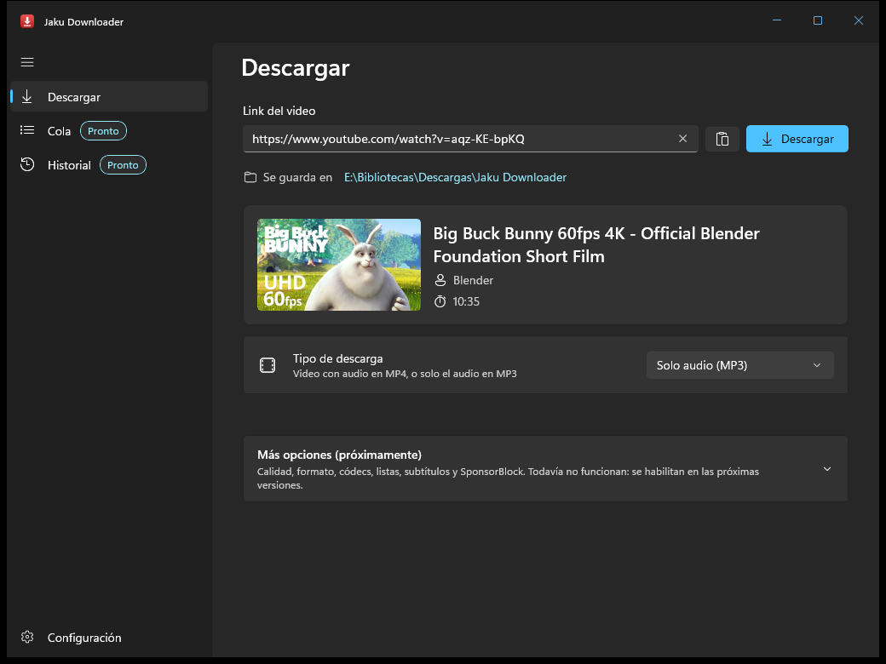

# Jaku Downloader

Descargador de audio y video para Windows, hecho con WinUI 3 y .NET.

La primera meta es YouTube. Más adelante, si es viable, se suman otros sitios como Facebook, X, Instagram y TikTok.

**Versión actual:** v00.06.00 (en desarrollo)



---

## Características

### YouTube

Descarga
- Videos, podcasts y música
- Extracción solo de audio, con salida en mp3 y otros formatos
- Filtro por calidad y resolución
- Selección de códecs específicos
- Listas de reproducción y canales completos

Contenido adicional
- Subtítulos: descarga e incrustación directa en el archivo
- Capítulos integrados en el archivo
- Saltar segmentos patrocinados (SponsorBlock)

Red
- Uso de cookies del navegador, para videos con restricción de edad o que requieren sesión
- Proxies HTTP y SOCKS
- Límite de velocidad de descarga

> Sobre VPN: la app no gestiona conexiones VPN. Si hay una VPN activa en el sistema, las descargas pasan por ella como cualquier otro tráfico. Para redirigir solo las descargas de Jaku Downloader se usa la opción de proxy.

### Otros sitios (futuro)

Facebook, X, Instagram y TikTok. El motor de descarga (yt-dlp) ya los soporta, así que el trabajo pasa por adaptar la interfaz y probar cada sitio.

---

## Roadmap

De lo más básico a lo más complejo. Cada versión tiene que funcionar por sí sola antes de pasar a la siguiente.

### v00.01.00 - Lo mínimo
- [x] Ventana con una caja de texto para el link
- [x] Botón "Descargar"
- [x] Toast de Windows que avisa dónde se va a guardar el archivo
- [x] Descarga en la mejor calidad disponible (mp4) a `Descargas\Jaku Downloader`
- [x] yt-dlp y FFmpeg se toman de la carpeta `tools\` junto al ejecutable

### v00.02.00 - Feedback básico
- [x] Barra de progreso, velocidad y tiempo restante
- [x] Botón para cancelar
- [x] Mensajes de error legibles (link inválido, video privado, sin conexión)
- [x] Toast al terminar, con acceso a la carpeta

### v00.03.00 - Información del video
- [x] Vista previa: miniatura, título, canal y duración
- [x] Elegir entre video o solo audio
- [x] Audio a mp3

### v00.04.00 - Calidad y formatos
- [x] Selector de resolución
- [x] Selector de formato de salida (mp4, mkv, webm, mp3, m4a, opus, flac, wav)
- [x] Selección de códecs de video y audio

### v00.05.00 - Ajustes y herramientas
- [x] Página de ajustes: carpeta de destino y plantilla de nombre de archivo
- [x] Descarga automática de yt-dlp, FFmpeg y Deno si faltan
- [x] Botón para actualizar yt-dlp desde la app

### v00.06.00 - Cola de descargas
- [x] Varias descargas a la vez, con límite configurable
- [x] Pausar, cancelar y reintentar por elemento
- [x] Historial de descargas

### v00.07.00 - Listas y canales
- [ ] Descargar listas de reproducción completas
- [ ] Descargar canales
- [ ] Elegir qué elementos de la lista bajar

### v00.08.00 - Subtítulos y capítulos
- [ ] Descargar subtítulos por idioma
- [ ] Incrustar subtítulos en el archivo
- [ ] Incrustar capítulos
- [ ] Incrustar miniatura y metadatos en archivos de audio

### v00.09.00 - SponsorBlock
- [ ] Marcar o eliminar segmentos patrocinados
- [ ] Elegir qué categorías saltar

### v00.10.00 - Red
- [ ] Cookies desde el navegador o desde archivo
- [ ] Proxy HTTP / SOCKS
- [ ] Límite de velocidad

### v01.00.00 - Primera versión estable
- [ ] Revisión general de errores y textos
- [ ] Instalador / versión portable publicada en GitHub Releases

### v01.xx.xx - Otros sitios
- [ ] Facebook
- [ ] X
- [ ] Instagram
- [ ] TikTok

---

## Cómo funciona

Jaku Downloader es una interfaz sobre herramientas de línea de comandos ya probadas:

```
Interfaz (WinUI 3)
      |
  Servicios (.NET)
      |
      +-- yt-dlp   -> obtiene la info y descarga
      +-- FFmpeg   -> une, convierte e incrusta
      +-- Deno     -> runtime JS que yt-dlp necesita para YouTube
```

La app lanza estos programas como procesos, lee su salida para mostrar el progreso y entrega el archivo final en la carpeta elegida.

---

## Requisitos

Para usar:
- Windows 10 (1809 o superior) o Windows 11
- Nada más: yt-dlp, FFmpeg y Deno vienen incluidos en la carpeta `tools\`. Si falta alguno, la app ofrece bajarlo (unos 130 MB la primera vez) y yt-dlp se actualiza desde Configuración.

Para compilar:
- Visual Studio 2022 o 2026 con la carga de trabajo de desarrollo de aplicaciones WinUI
- .NET SDK 10
- Windows App SDK

---

## Compilar

```bash
git clone https://github.com/jakuarg/JakuDownloader.git
```

1. Bajar las herramientas (una sola vez, o cuando cambien las versiones):
   ```powershell
   .\scripts\get-tools.ps1
   ```
2. Abrir `JakuDownloader.sln` en Visual Studio.
3. Compilar y ejecutar (F5). Todo lo que está en `tools\` se copia junto al ejecutable.

El script baja versiones fijas desde los releases oficiales y verifica el SHA-256 de cada archivo:
- yt-dlp: https://github.com/yt-dlp/yt-dlp/releases
- FFmpeg (build LGPL compartida): https://github.com/BtbN/FFmpeg-Builds/releases
- Deno: https://github.com/denoland/deno/releases

Para cambiar de versión se editan las variables al principio de `scripts\get-tools.ps1`. Con `-Force` se vuelve a bajar todo.

Los binarios no se suben al repositorio, pero sí van incluidos en la versión publicada en GitHub Releases: se descomprime y funciona.

---

## Estructura del repositorio

```
JakuDownloader/
├─ src/
│  └─ JakuDownloader/
│     ├─ Models/
│     ├─ Services/
│     ├─ ViewModels/
│     ├─ Views/
│     ├─ Helpers/
│     └─ tools/          (ignorada por git)
├─ docs/
│  └─ screenshots/
├─ scripts/
│  └─ get-tools.ps1
├─ .editorconfig
├─ .gitignore
├─ JakuDownloader.sln
├─ LICENSE
└─ README.md
```

---

## Tecnologías

| Uso | Herramienta |
|---|---|
| Lenguaje | C# / .NET 10 |
| Interfaz | WinUI 3 (Windows App SDK) |
| MVVM | CommunityToolkit.Mvvm |
| Inyección de dependencias | Microsoft.Extensions.Hosting |
| Notificaciones | Toasts de Windows (`Windows.UI.Notifications`) |
| Descarga | yt-dlp |
| Conversión | FFmpeg |
| Runtime JS para yt-dlp | Deno |

---

## Versionado

Formato `vXX.ZZ.YY`:

- `XX` - versión mayor. Cambia con cambios grandes o incompatibles.
- `ZZ` - versión menor. Cambia con funcionalidades nuevas (cada etapa del roadmap).
- `YY` - parche. Cambia con correcciones de errores.

Ejemplo: `v00.01.00` es la primera versión funcional y `v00.01.01` es su primera corrección.

---

## Convenciones de código

- Nombres de clases, métodos y variables en inglés.
- Comentarios en español y sin acentos.
- Comentarios solo donde aportan: el porqué, no el qué.
- `/// <summary>` en clases y métodos públicos cuando el nombre no alcanza para entenderlos. No en todo.
- Un archivo por clase. Organización por carpetas: `Models`, `Services`, `ViewModels`, `Views`, `Helpers`.
- Commits cortos y descriptivos, en español.

---

## Notas de desarrollo

Referencia rápida de qué opción de yt-dlp cubre cada característica:

| Característica | yt-dlp |
|---|---|
| Información del video | `--skip-download -O "%(.{id,title,channel,duration,thumbnail,live_status})j"` (solo esos campos; `-J` trae cientos de KB) |
| Mejor calidad | `-f "bv*+ba/b" -S "res,fps,vcodec:h264,acodec:aac"` (a igual resolución prefiere H.264 + AAC) |
| Límite de resolución | `-S "res:1080,..."` (la mejor hasta ese alto; si no hay, la más baja disponible) |
| Códec de video | `-f "bv*[vcodec~='^vp0?9']+ba/bv*+ba/b"` (si no está en ese códec, cae al mejor) |
| Códec de audio | `-S "...,acodec:opus"` o `acodec:aac` |
| WebM | `-f "bv*[ext=webm]+ba[ext=webm]/b[ext=webm]/bv*+ba/b"` (VP9 + Opus) |
| Solo audio sin recomprimir | `-f "ba[ext=m4a]/ba/b"` para M4A, `-f "ba[acodec=opus]/ba/b"` para Opus |
| Solo audio a mp3 | `-x --audio-format mp3 --audio-quality 0` |
| Contenedor de salida | `--merge-output-format mp4` / `--remux-video mkv` |
| Listas y canales | `--yes-playlist`, `--playlist-items` (con links `/playlist`, `/@canal`, etc. yt-dlp ignora `--no-playlist`: la app los detecta antes) |
| Subtítulos | `--write-subs --sub-langs es,en --embed-subs` |
| Capítulos | `--embed-chapters` |
| Miniatura y metadatos | `--embed-thumbnail --embed-metadata` |
| SponsorBlock | `--sponsorblock-remove sponsor` / `--sponsorblock-mark all` |
| Cookies | `--cookies-from-browser <navegador>` / `--cookies <archivo>` |
| Proxy | `--proxy socks5://host:puerto` |
| Límite de velocidad | `-r 2M` |
| Progreso parseable | `--progress --newline --progress-template ...` (`--print` silencia el progreso si no se fuerza con `--progress`) |
| Archivos intermedios | `-P <carpeta temporal>`: yt-dlp trabaja solo ahí y la app mueve el archivo final al destino |
| Ubicación de herramientas | `--ffmpeg-location`, `--js-runtimes deno:<ruta>` |
| Actualizar | `-U` |

Puntos a tener en cuenta:
- La interfaz ya tiene los controles de todo el roadmap. Las funciones que faltan se muestran deshabilitadas con un distintivo "Próximamente · vXX.ZZ"; al implementar una versión se pone en `true` su interruptor en `Helpers/Features.cs` y los controles se habilitan solos.
- Lanzar procesos con `ProcessStartInfo.ArgumentList` para no romper rutas con espacios.
- Forzar UTF-8 en la salida (`--encoding utf-8`) para títulos con acentos o emojis.
- Cancelar matando el árbol de procesos. yt-dlp trabaja solo en una carpeta oculta `.jaku-temp\<id>` dentro del destino (mismo disco, así mover el archivo final es instantáneo); al cancelar o fallar se borra esa carpeta.
- yt-dlp nunca tiene que ver la carpeta de destino: si encuentra un archivo con el mismo nombre que su intermedio (por ejemplo un video `.webm` al bajar solo el audio de ese video), lo toma como propio y lo borra después de extraer el audio. Por eso el archivo final lo mueve la app, y si el nombre ya existe agrega " (2)".
- Actualizar la UI desde otros hilos con `DispatcherQueue`.
- Configuración: `%LOCALAPPDATA%\Jaku Downloader\settings.json`. Solo guarda lo que difiere del valor por defecto.
- Historial: `%LOCALAPPDATA%\Jaku Downloader\history.json`, hasta 1000 entradas. Guarda las opciones de cada descarga para "Descargar de nuevo". Quitar del historial no borra el archivo.
- Cola: corre en el hilo de la interfaz y arranca las más viejas primero, hasta el límite de Configuración (3 por defecto). Pausar mata el proceso pero conserva la carpeta de trabajo; al reanudar, yt-dlp retoma desde los `.part`. La cola no se guarda: al cerrar la app se cancela lo pendiente, con confirmación.
- Herramientas: se buscan primero en `tools\` junto al ejecutable y después en `%LOCALAPPDATA%\Jaku Downloader\tools`. Si la carpeta de la app no admite escritura (por ejemplo en `Program Files`), las que faltan se instalan en la del usuario. La app las baja de los mismos releases que `scripts\get-tools.ps1` y verifica el SHA-256 antes de instalarlas.
- Actualizar yt-dlp es `yt-dlp -U`; la app compara `--version` antes y después para saber si cambió. No se puede mientras hay una descarga, porque el ejecutable está en uso.
- Toasts: Windows no muestra los de una app sin empaquetar si no tiene un acceso directo en Inicio con su AppUserModelID. La app crea `Jaku Downloader.lnk` al iniciar y usa el ID `JakuDownloader`. `AppNotificationManager` no sirve para esto: registra su propio ID y los toasts se entregan pero no aparecen.
- YouTube cambia seguido. Casi todos los errores raros ("confirm you're not a bot", formatos faltantes) se arreglan actualizando yt-dlp.

---

## Licencia

Distribuido bajo la licencia [MIT](LICENSE).

Podés usar, copiar, modificar y redistribuir este programa, incluso con fines comerciales, siempre que se mantenga el aviso de copyright y la licencia original, es decir, dando crédito al autor.

---

## Créditos

Jaku Downloader se apoya en estos proyectos:

- [yt-dlp](https://github.com/yt-dlp/yt-dlp) - Unlicense
- [FFmpeg](https://ffmpeg.org) - LGPL (build de [BtbN](https://github.com/BtbN/FFmpeg-Builds), licencia incluida en `tools\FFMPEG-LICENSE.txt`)
- [Deno](https://deno.com) - MIT
- [Windows App SDK](https://github.com/microsoft/WindowsAppSDK) - MIT
- [CommunityToolkit](https://github.com/CommunityToolkit/dotnet) - MIT
- [SponsorBlock](https://sponsor.ajay.app) - datos bajo CC BY-NC-SA 4.0

---

## Aviso legal

Este proyecto tiene fines educativos y de uso personal. Cada usuario es responsable de respetar los términos de servicio de cada sitio y los derechos de autor del contenido que descarga. No uses esta herramienta para redistribuir contenido sin permiso.
